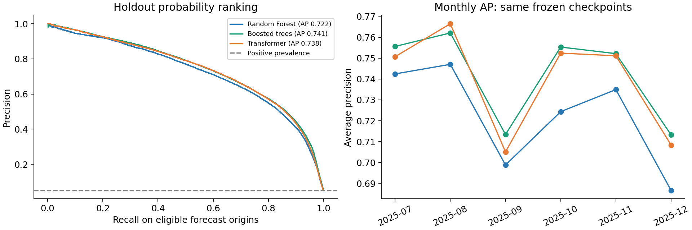
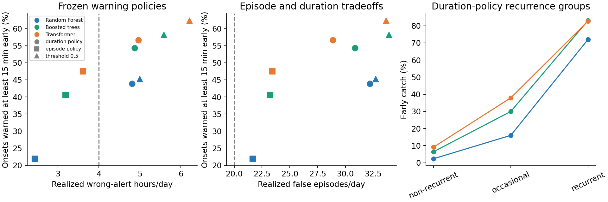
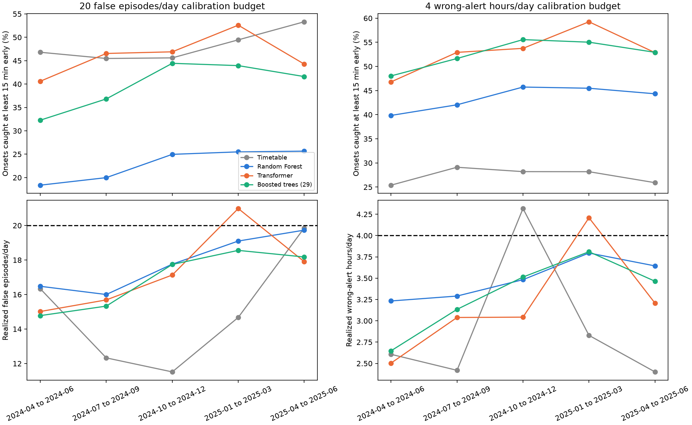
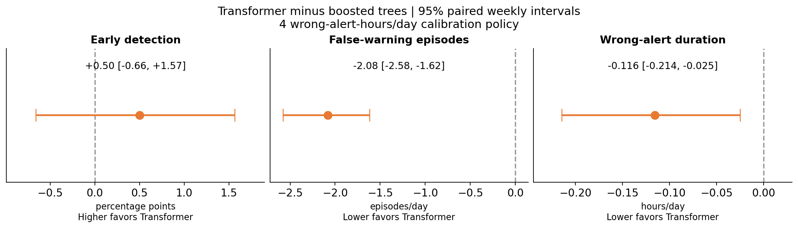
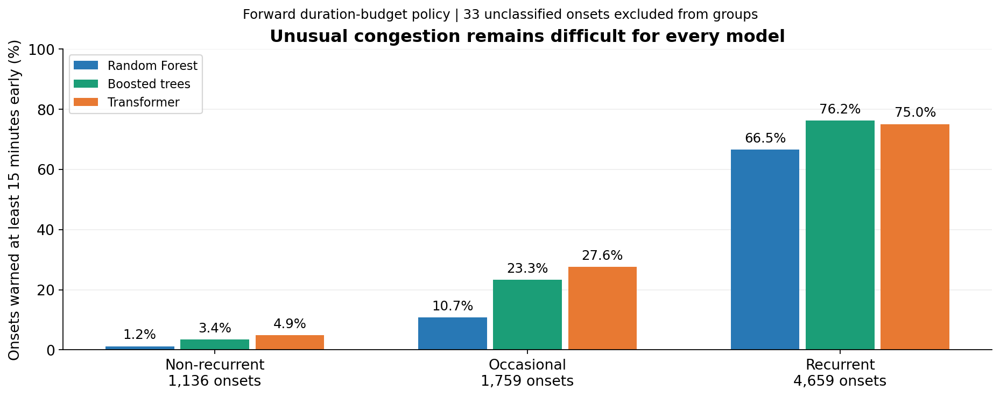
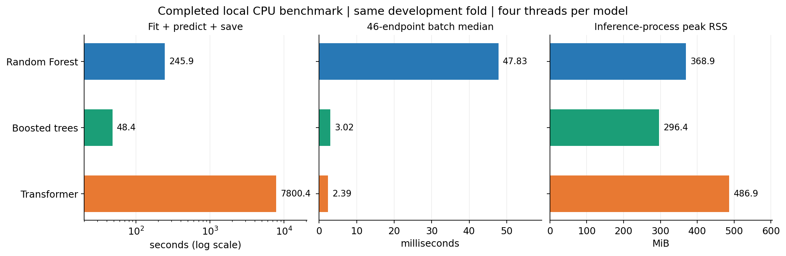

# SafeFlow

**Early warning of freeway congestion from recent traffic measurements.**

SafeFlow asks whether a traffic station will become congested within the next 30 minutes, and whether that warning can arrive early enough to be useful without generating too many false alerts. We compare tabular tree models with a Transformer using a shared set of traffic, spatial and temporal features.

> **Project status: development, November 2026.** The current comparison uses D12 data. Development validation and forward warning-policy analyses are complete; the full local benchmark is complete. The July-December 2025 holdout has now been evaluated once using frozen checkpoints and development-calibrated thresholds. No final model has been selected.

[Problem](#the-problem) | [Stakeholders](#stakeholders) | [Dataset](#the-dataset) | [Models](#the-models) | [Metrics](#how-performance-is-measured) | [Results](#what-we-have-found) | [Current workflow](#current-workflow-and-planned-delivery)

## The problem

Transportation agencies need more than a description of congestion that has already formed. An early-warning system should identify developing slowdowns while leaving enough time to assess traffic-management responses. Its usefulness depends on both **how early it warns** and **how much warning burden it creates**.

Our prediction unit is **one station at one 5-minute timestamp**. The binary target is:

> Will measured speed be **strictly below 40 mph at any of the next six 5-minute readings**?

For example, a forecast at 08:00 looks at 08:05 through 08:30. One reading below 40 mph makes the target positive; the 08:00 reading itself is excluded. This definition includes brief slowdowns rather than requiring multiple consecutive congested readings.

We evaluate warning quality separately from this target. An **onset** is a congested reading following at least 30 minutes of measured, uncongested readings. An onset is caught early if a warning occurs **15-30 minutes before it begins**.

## Stakeholders

The primary stakeholders are **transportation agencies and traffic management centers**, including teams responsible for freeway operations. Advance warnings could help operators prioritize attention to developing congestion and assess whether a traffic-management response is warranted.

| Stakeholder | Potential value | What matters in evaluation |
| --- | --- | --- |
| Traffic management center operators | Identify developing slowdowns and prioritize corridor monitoring | Useful warning lead time, manageable false alerts and reliable predictions |
| Transportation agency planners and operations teams | Assess where early-warning tools could support freeway management | Performance across stations and time periods, computational cost and maintainability |
| Travelers and freight operators | Potential indirect benefit from better-informed traffic management | More reliable journeys; benefits would require deployment and impact evaluation |

SafeFlow currently evaluates predictions and warning policies. It does not yet establish that acting on its warnings reduces congestion or improves travel times.

## The dataset

The project uses local **Caltrans PeMS station measurements** and station metadata. The current evaluated corridor comprises **46 I-5 mainline stations in D12**. D7 data is available locally for future work but is not included in the results below.

| Component | Current scope |
| --- | --- |
| Available years | D12 2023, 2024 and 2025 |
| Measurement interval | 5 minutes |
| Traffic measurements | Speed, flow, occupancy and percentage observed |
| Spatial context | Station order, postmile, neighboring detectors and nearby ramps |
| Development period | January 2023-June 2025 |
| Holdout evaluation | July-December 2025; completed once with frozen checkpoints |
| Days retained | Weekdays, excluding US federal holidays |
| Forecast origins retained | 06:00-19:55; label availability further restricts training and scoring |
| Outcome eligibility | All six future readings must be measured for the target to be treated as known |

The development cache contains approximately **4.82 million station-time rows**, including rows without a complete future label. Missing outcomes are not silently treated as negative examples. Earlier readings from 04:00 are used for selected recent-history features, without expanding the evaluation hours.

Inputs are organized as daily Parquet files under `data/D12 <year>/pems_parquet/station_5min/`, with station metadata in `data/d12_text_meta_2021_05_18.txt`. The shared loader excludes holdout files before reading their contents. Raw data and large caches remain local.

### From measurements to features

All three models use the **same 29 logical features**, implemented in [safeflow_features.py](notebooks/safeflow_features.py).

| Feature family | Examples and purpose |
| --- | --- |
| Current conditions | Speed, occupancy and flow describe the traffic state |
| Recent changes | Speed deltas, a 30-minute speed lag and recent slow readings describe deterioration or recovery |
| Spatial conditions | Upstream/downstream speed differences, detector distance and downstream jam proximity describe conditions along the corridor |
| Typical patterns | Training-period congestion rates and speed/occupancy anomalies distinguish expected traffic from unusual conditions |
| Context | Time of day, weekday, postmile and nearby ramp flows provide temporal and spatial context |

Training-dependent typical values and anomalies are recomputed inside each fold using that fold's training period. The [feature-selection analysis](notebooks/analysis/feature_selection_results.ipynb) documents the development rationale; these features remain subject to the final validation protocol.

## The models

The comparison tests whether a sequence model offers enough predictive benefit to justify its additional operational requirements.

| Model | Why include it? | How it uses the inputs |
| --- | --- | --- |
| Random Forest | A nonlinear tabular baseline that captures interactions through an ensemble of bagged trees | Current engineered feature vector; median imputation, missingness indicators and weekday encoding |
| Boosted trees | A strong tabular approach that sequentially improves fitted predictions | Histogram gradient boosting on the engineered feature vector; native missing-value handling |
| Transformer | Tests whether attention over recent traffic history improves advance warning | Up to 24 historical feature vectors, with training-only preprocessing and padding for unavailable history |
| Timetable baseline | Tests how much can be predicted from recurring congestion patterns alone | The training-period usual congestion rate for a station and time |

The shared feature list does **not** make the inputs identical: the Transformer additionally sees a sequence of those features. The tree models already have engineered temporal and spatial features, but do not consume the same full sequence.

Full local benchmark settings use 300 Random Forest trees, 300 boosting iterations and ten Transformer epochs. Implementations live in [src/random_forest](src/random_forest/README.md), [src/boosted_trees](src/boosted_trees/README.md) and `src/transformer/`.

## Validation: testing on later traffic

Random train/test splits would mix earlier and later traffic conditions. We instead use **six quarterly walk-forward folds**, covering 2024 Q1 through 2025 Q2. Each fit uses earlier data, with a **seven-day gap** before its validation quarter and complete target windows on the training side of that gap.

There are two complementary development comparisons:

1. **Model quality across six quarters:** evaluate saved out-of-fold probabilities and report AP, probability error and warning metrics.
2. **Forward warning policies across five quarters:** select each model's threshold using earlier out-of-fold quarters only, freeze it, then measure detection and actual burden in the next quarter. Q1 2024 initializes threshold calibration; Q2 2024 through Q2 2025 are evaluated.

The holdout was accessed only after the checkpoints, feature rules and threshold policies were frozen. Forward threshold testing remains development evidence: the broader feature and model choices have already been informed by development results.

## How performance is measured

Congestion onset is relatively uncommon among currently uncongested forecast origins. We therefore examine ranking, probability quality and operational warning behavior together.

| Metric | What it tells us | Preferred direction |
| --- | --- | --- |
| Average precision (AP) | How well probabilities rank positive outcomes across thresholds; the primary `AP, onsets` score uses measured, currently uncongested origins with known future labels | Higher |
| Brier score | Mean squared error of predicted probabilities against known binary outcomes | Lower |
| Onsets caught at least 15 minutes early | Fraction of onset events with a warning 15-30 minutes beforehand | Higher |
| False-warning episodes/day | Starts of consecutive warning readings whose known future target is negative | Lower |
| Wrong-alert hours/day | Total duration of those wrong-warning readings, summed across stations per day | Lower |
| Latency, memory and training cost | Whether the predictive benefit is practical on the available hardware | Lower cost for comparable predictive value |

Despite its saved name, **`AP, onsets` is a ranking metric over eligible forecast origins, not event detection recall**. Both measures are needed. Likewise, a threshold of 0.5 can produce different alert volumes for different models because their score distributions and calibration differ.

## What we have found

### Holdout evaluation: July-December 2025

| Model | Holdout AP | Brier | Early catch: duration policy | Actual wrong hours/day |
| --- | --- | --- | --- | --- |
| Boosted trees | 0.7412 | 0.0238 | 54.3% | 4.87 |
| Transformer | 0.7380 | 0.0240 | 56.7% | 4.97 |
| Random Forest | 0.7216 | 0.0248 | 43.9% | 4.81 |

These frozen models were fitted before April; April-June predictions calibrated their thresholds. They were not refitted through June. All three models exceeded the 4 wrong-alert-hours/day budget on holdout, so the higher detection rates do not establish compliant operation at that cap.





Transformer's duration-policy detection advantage is 2.34 percentage points (paired weekly 95% interval +1.19 to +3.49), with slightly higher wrong-alert duration. Boosted trees have the highest AP point estimate. These are not exactly matched-cost comparisons. [Full holdout report](results/holdout_evaluation/20261104_160843_077282/HOLDOUT_REPORT.md) and [frozen protocol](results/holdout_evaluation/20261104_160843_077282/frozen_protocol.json).

The development results below retain their original scope and values.

### 1. Boosted trees lead on mean AP; Transformer is close

| Model | Mean AP | AP standard deviation | Worst-fold AP | Mean Brier |
| --- | --- | --- | --- | --- |
| Boosted trees | **0.7666** | 0.0110 | 0.7552 | **0.0220** |
| Transformer | 0.7625 | 0.0168 | 0.7317 | 0.0223 |
| Random Forest | 0.7495 | 0.0088 | 0.7384 | 0.0230 |


These are published six-fold development results, including the November 4 boosted-tree update. Whiskers show fold standard deviation, **not confidence intervals**. A higher mean AP does not automatically imply better early event detection. [Source metrics](notebooks/results/summary.csv).

### 2. Early detection depends on the warning policy

Under the **4 wrong-alert-hours/day calibration policy**, the five forward-evaluation quarters contain 7,587 onsets:

| Model | Onsets caught early | Actual false episodes/day | Actual wrong-alert hours/day | Quarters over the duration budget |
| --- | --- | --- | --- | --- |
| Transformer | **53.2%** | 21.12 | 3.19 | 1/5 |
| Boosted trees | 52.7% | 23.21 | 3.31 | 0/5 |
| Random Forest | 43.5% | 26.09 | 3.49 | 0/5 |



The dashed lines are calibration budgets, not constraints imposed using future outcomes. The models have equal **intended** budgets, but different realized costs. The episode-budget policy produces a different tradeoff, which is why both episode counts and warning duration are reported. [Forward-policy analysis](notebooks/analysis/forward_warning_budget_validation.ipynb).

### 3. The small detection advantage is uncertain



Transformer's early-detection advantage over boosted trees is **0.50 percentage points**, with a weekly 95% interval of **-0.66 to +1.57 points**. This does not clearly distinguish their detection performance or establish equivalence. Transformer generated lower average warning burden under this frozen duration policy.

Intervals use 5,000 paired weekly resamples within quarters, keeping stations together. They condition on the saved fitted models and thresholds; they do not include retraining or feature/model-selection uncertainty. [Paired uncertainty analysis](notebooks/analysis/model_decision_analysis.ipynb).

### 4. Non-recurrent congestion is the main predictive weakness



Among 1,136 non-recurrent onsets, early detection under the duration policy was only **4.9% for Transformer, 3.4% for boosted trees and 1.2% for Random Forest**. Recurrence uses the training-only usual congestion rate 15 minutes before onset; 33 events without usable recurrence context are excluded from the groups but retained in overall detection. Strong aggregate scores do not resolve this weakness.

### 5. Completed local benchmarking shows different training and inference tradeoffs



| Model | Last-fold AP | Fit/predict/save | Batch 46 median | Inference peak RSS |
| --- | --- | --- | --- | --- |
| Random Forest | 0.7509 | 4.10 min | 47.83 ms | 368.9 MiB |
| Boosted trees | 0.7669 | 0.81 min | 3.02 ms | 296.4 MiB |
| Transformer | 0.7713 | 130.01 min | 2.39 ms | 486.9 MiB |

Transformer has the highest AP in this fresh last-fold run and the lowest warm small-batch latency. Its fit/predict/save stage took about **130 minutes**, versus **0.81 minutes** for boosted trees and **4.10 minutes** for Random Forest. Boosted trees were faster over the complete 38,640-endpoint fixture: **0.50 seconds**, versus **2.03 seconds** for Transformer and **4.00 seconds** for Random Forest. Inference speed therefore depends on batch size and whether encoding/building costs are included.

All models used the same April-June 2025 development fold, two million training endpoints and four CPU threads. All three saved checkpoints passed prediction reproduction checks.

These are fresh one-fold results, not replacements for the six-fold published means or the earlier forward policies. At threshold 0.5, Transformer's higher early catch also came with greater warning burden. Small-batch latency starts from cached engineered features; raw-to-feature extraction is excluded. Peak RSS includes dependencies, fixture data and optional stress tests. No holdout data was used. [Benchmark notebook](notebooks/analysis/local_model_benchmark.ipynb) and [completed run tables](results/local_model_benchmark/20261104_115016_080613/manifest.json).

## What remains before a final decision

Transformer and boosted trees remain the leading candidates. The local benchmark is complete. We still need to assess the practical value of their performance differences and improve or better characterize unusual-onset failures.

Current evidence is limited to this D12 corridor and development period; performance on D7 or a combined analysis is not established. The historical Transformer export also records a different shared-feature source hash from the current module. Fresh local fits use the current shared source, but do not establish exact reproduction of that historical run.

The frozen-checkpoint holdout evaluation is complete. Further model or policy tuning requires new independent validation; this same period can no longer serve as an untouched test. The [visual results overview](results/RESULTS_SUMMARY.md) preserves detailed tables, artifact links and the completed local benchmark snapshot.

## Current workflow and planned delivery

**The current research workflow uses notebooks.** Shared feature construction and reusable model/analysis code already live in Python modules. At project completion, the notebooks will be converted into executable scripts, and this section will be updated with the final script-based usage instructions.

For now:

1. Place the D12 yearly folders and metadata under `data/` using the structure described above.
2. Activate the project environment and install the base dependencies:

   ```bat
   conda activate erdos_ds_environment
   python -m pip install -r requirements.txt
   ```

3. Open a model's training notebook using that environment's kernel: [Random Forest](notebooks/train_random_forest.ipynb), [boosted trees](notebooks/train_boosted_trees.ipynb), or [Transformer](notebooks/train_transformer.ipynb). Use quick mode for pipeline checks before full training. Transformer and local benchmarking additionally require [requirements-benchmark.txt](requirements-benchmark.txt):

   ```bat
   python -m pip install -r requirements-benchmark.txt
   ```

4. Follow the [notebook guide](notebooks/README.md) for saved results, error analysis, forward threshold validation and local benchmarking. The forward analysis requires the context cache generated by the all-model error analysis.

Current training notebooks stay at their existing paths. Large data, caches and fitted checkpoints remain local; benchmark runs do not automatically overwrite the published team summary.

## Repository map

| Location | Purpose |
| --- | --- |
| `notebooks/` | Current training entry points and shared feature module |
| `notebooks/eda/` | Data exploration and historical extraction |
| `notebooks/analysis/` | Feature-selection evidence, comparisons, error analysis and benchmarks |
| `notebooks/archive/` | Earlier targets and superseded experiments |
| `notebooks/results/` | Published team summary and per-fold model metrics |
| `src/{random_forest,boosted_trees,transformer}/` | Reusable model implementations and local run artifacts |
| `src/analysis/` | Scoring, uncertainty and benchmark helpers with tests |
| `data/` | Local raw inputs and processed datasets |
| `results/` | Analysis artifacts, summary figures and the detailed results overview |

Archived notebooks may use different targets and validation conventions; their scores are not directly comparable with the current 29-feature workflow. The [relocation map](notebooks/notebook_locations.json) records where earlier notebooks moved. Figures used here and their sources are documented in the [figure manifest](results/figures/summary/manifest.json).
