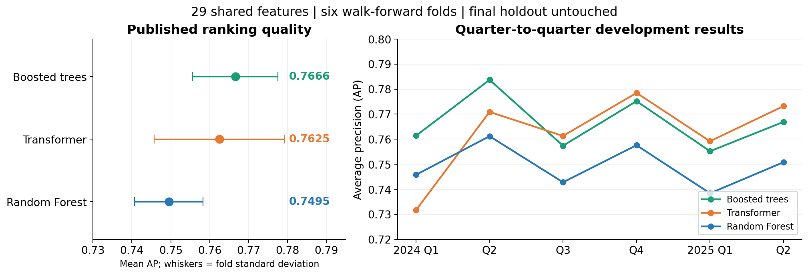

# SafeFlow

SafeFlow predicts whether a freeway station will have measured speed **below 40 mph at any of the next six 5-minute readings** (the next 30 minutes). The current comparison uses D12 data and one shared 29-feature set.

Explore the [visual results overview](results/RESULTS_SUMMARY.md) for current findings, uncertainty and benchmark progress.

*Development evidence; local Transformer benchmarking is in progress. The final holdout remains untouched.*

## Start here

1. Put D12 2023, D12 2024, D12 2025 and station metadata under `data/` (Windows also accepts `Data/`). See [data inventory](data_inventory.md).
2. Use a training notebook in [notebooks/](notebooks/README.md): `train_random_forest.ipynb`, `train_transformer.ipynb`, or `train_boosted_trees.ipynb`. Start with `QUICK_RUN = True`; full runs produce the six development folds.
3. Compare published metrics in `notebooks/results/summary.csv`. Use [model error analysis](notebooks/analysis/error_analysis_models.ipynb) for aligned saved predictions and exploratory warning budgets.
4. Use [forward warning-budget validation](notebooks/analysis/forward_warning_budget_validation.ipynb) to select thresholds on earlier quarters and evaluate them unchanged in the next quarter. Run the error analysis first if its context cache is absent.

Use [model decision analysis](notebooks/analysis/model_decision_analysis.ipynb) for paired uncertainty and the operational readiness audit before selecting a final model. The [local benchmark](notebooks/analysis/local_model_benchmark.ipynb) trains fresh fits for CPU speed and memory measurements; exact historical-fit benchmarks require the original checkpoints.

Validation uses six quarterly walk-forward folds from 2024 Q1 through 2025 Q2, with a seven-day training gap. July-December 2025 remains the final holdout. AP measures ranking quality; early-onset detection and warning burden answer different operational questions.

## Repository layout

| Location | Purpose |
| --- | --- |
| `notebooks/` | Training entry points and shared `safeflow_features.py` |
| `notebooks/eda/` | Exploratory data checks and historical extraction |
| `notebooks/analysis/` | Feature-selection evidence, model comparisons, error analysis and forward policy validation |
| `notebooks/archive/` | Earlier targets, horizon experiments and superseded workflows |
| `notebooks/results/` | Shared published summary and per-fold model tables |
| `src/{random_forest,transformer,boosted_trees}/` | Model implementations and their local run artifacts |
| `src/analysis/` | Reusable analysis and scoring helpers, with tests |
| `data/` | Raw inputs and processed data; not moved by the notebook reorganization |
| `results/` | Timestamped analysis artifacts and historical experiments |

The shared feature module and existing data/result paths stay in place. Notebooks discover the project root from ancestor folders, so launch Jupyter from the repository or the notebook's own folder. Training notebooks remain at their original paths for team compatibility. See the [notebook guide](notebooks/README.md) and [old-to-new location map](notebooks/notebook_locations.json).

Archived notebooks preserve their original research context and saved outputs. Their targets and validation conventions can differ from the current workflow; their scores should not be compared directly with current 29-feature results. Some historical EDA requires additional datasets such as PeMS Bay.
