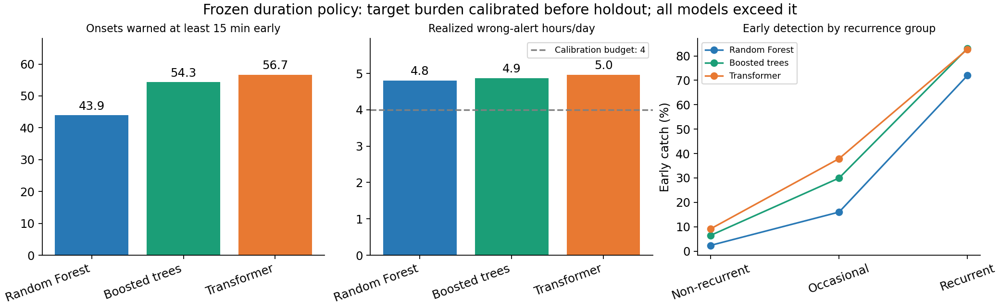

# SafeFlow — Executive summary

**Freeway congestion can be anticipated, but the current models produce too many false warnings to meet our proposed operating targets.** Boosted trees and Transformer are promising candidates for further development; neither is designated as the final model.

SafeFlow explores whether traffic measurements can help transportation agencies and traffic management centers identify emerging congestion early enough to prioritize monitoring. Every five minutes, it predicts whether a station's speed will fall below 40 mph at any reading in the next 30 minutes. Success requires useful advance notice without overwhelming operators. We have not tested whether acting on these warnings improves traffic flow or travel times.

The study compares Random Forest, boosted trees and Transformer using measurements from 46 D12 I-5 mainline stations. All use 29 shared features describing local traffic, neighboring detectors and typical conditions; Transformer also processes historical sequences. Models were fitted using training target windows ending before March 25, 2025. April–June data set the warning thresholds, which were then frozen for a July–December 2025 holdout containing **3,497 congestion onsets across 125 eligible days**. Models were not refitted through June.

A **warning policy** converts a predicted probability into an alert using a model-specific threshold. A **warning budget** is a target for acceptable false-warning burden, not a financial budget or a guaranteed future limit. Our primary policy selected thresholds to maximize early detection while keeping calibration false-warning duration within **four hours/day, summed across all stations**. For example, simultaneous 30-minute false warnings at two stations contribute one hour. This illustrative target still requires validation with intended users.

Under this frozen policy, Transformer warned of **56.7%** of holdout onsets 15–30 minutes early, compared with **54.3%** for boosted trees and **43.9%** for Random Forest. However, false-warning duration reached **4.97, 4.87 and 4.81 hours/day**, respectively: **all three exceeded the target**. A separate policy targeting at most 20 false-warning episodes/day also exceeded its target for every model. An episode is one uninterrupted sequence of false warnings at a station.

*Frozen-policy holdout results: all models exceed the four-hour target, and early detection is substantially weaker for unusual congestion. Daily warning duration adds contributions across stations.*

Transformer's early-detection advantage over boosted trees was **2.34 percentage points** (paired weekly 95% interval: **1.19–3.49**), at slightly higher false-warning duration. These are not exactly matched-cost results. Boosted trees ranked future congestion slightly better and were substantially faster to fit in the local CPU benchmark. The evidence supports a tradeoff between the leading candidates rather than a single overall winner.

The largest weakness is unusual congestion: among 634 onsets classified as non-recurrent from training-derived traffic patterns, early detection was only **9.1% for Transformer and 6.5% for boosted trees**. This classification describes unusual timing, not a confirmed incident cause. Results are limited to this corridor, and robustness to real detector outages remains unproven.

**Recommendation:** retain all three models and continue developing the two leading candidates. Agree on acceptable warning burden with operators, investigate missed unusual events, and assess improvements and retraining on a new independent period. Both leading models demonstrate the predictive feasibility of the target design, but neither establishes budget-compliant operational readiness. The holdout has now been used; further work must not treat it as an untouched final test.
