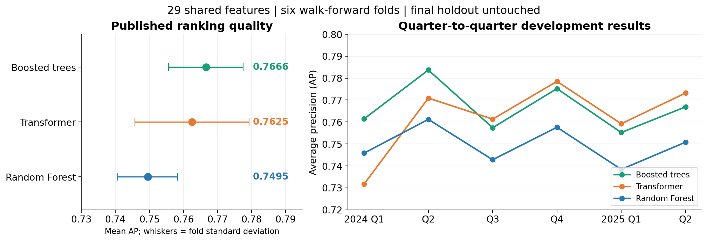
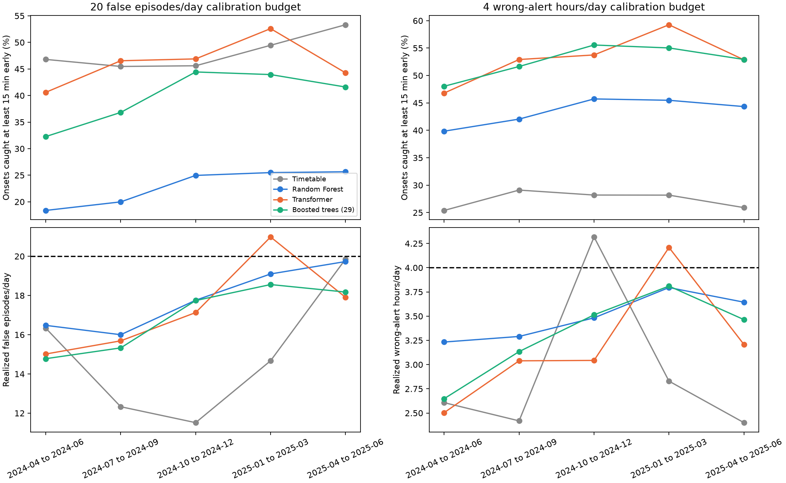
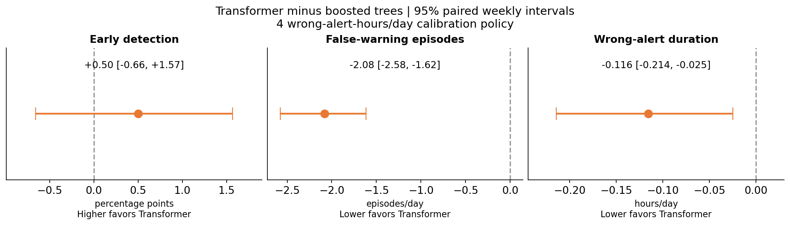
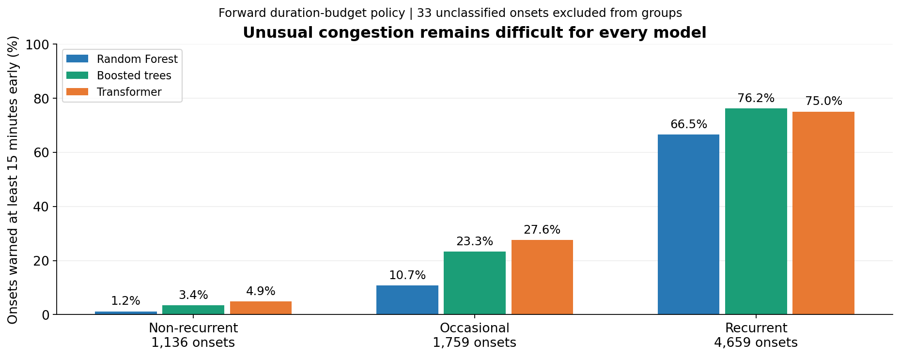
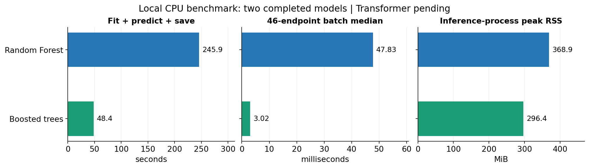

# SafeFlow: congestion early warning

**Can we warn of freeway congestion before it starts, at a manageable warning burden?**

At each station, every five minutes, predict whether measured speed will fall below **40 mph at any point in the next 30 minutes**. This page is a working overview of the repository's results, with completed evidence separated from pending work.

> **In progress - 2026-11-04 13:03 EST.** Six-fold development comparison and forward warning-policy analysis are complete. The local Transformer benchmark is training (4/10 epochs complete); its validation and operational measurements are pending. **The July-December 2025 holdout remains untouched.**

[Training and notebook guide](../notebooks/README.md) | [Project setup](../README.md) | [Published metrics](../notebooks/results/summary.csv) | [Detailed tables and methods](#detailed-tables-and-methods)

## What the evidence says so far

- **Boosted trees lead on ranking quality:** mean development AP **0.7666**, compared with **0.7625** for Transformer and **0.7495** for Random Forest.
- **Transformer and boosted trees are close on early detection:** **53.2% versus 52.7%** under the forward duration-budget policy. The paired interval does not clearly separate them; Transformer generated lower average warning burden under that policy.
- **Unusual congestion is the main weakness:** all models miss most non-recurrent onsets when at least 15 minutes of warning is required.

## 1. Ranking quality across time

Boosted trees have the highest published mean AP; Transformer is close. The whiskers show **fold standard deviation, not confidence intervals**. These are the current six-fold results, including the November 4 boosted-tree update. AP measures ranking of eligible forecast origins; it is not the fraction of onset events warned early.

[Source tables](../notebooks/results/summary.csv) | [Comparison notebook](../notebooks/analysis/compare_models_29_features.ipynb)

## 2. Do warning budgets carry into the next quarter?

Thresholds are selected using **earlier quarters only**, then frozen for the next quarter. Dashed lines are calibration budgets; actual next-quarter costs may exceed them. Transformer exceeded each selected budget in one of five quarters. Under the duration policy, it caught **53.2%** of onsets versus **52.7%** for boosted trees and **43.5%** for Random Forest. These are equal intended budgets, not identical realized costs.

[Forward-policy notebook](../notebooks/analysis/forward_warning_budget_validation.ipynb) | [Quarterly results](forward_warning_budget_validation/20261104_102956_926783/quarterly_policies.csv)

## 3. Is the Transformer advantage convincing?

The primary detection difference is **+0.50 percentage points**, with a weekly 95% interval of **-0.66 to +1.57**. This does not establish superior detection or equivalence. The average false-episode and wrong-duration differences favor Transformer under this frozen duration policy. Intervals use 5,000 paired weekly resamples and condition on existing fitted models and thresholds; they do not cover feature selection, retraining uncertainty or future regime shifts.

[Uncertainty notebook](../notebooks/analysis/model_decision_analysis.ipynb) | [All intervals and daily sensitivity](model_decision_analysis/20261104_104058_694019/paired_intervals.csv)

## 4. The hard cases: non-recurrent congestion

Under the duration policy, Transformer caught only **4.9%** of non-recurrent onsets early, boosted trees **3.4%**, and Random Forest **1.2%**. Grouping uses each fold's training-only usual congestion rate 15 minutes before onset. The 33 onsets with missing recurrence context are excluded from these groups but retained in overall detection. Improving these hard cases matters more than a small aggregate-score gain.

[Recurrence results](forward_warning_budget_validation/20261104_102956_926783/recurrence_summary.csv) | [Error-analysis notebook](../notebooks/analysis/error_analysis_models.ipynb)

## 5. Deployment practicality: local benchmark in progress

These are **fresh full-size fits on the same last development fold**, with four CPU threads, 2,000,000 training endpoints and 486,864 validation endpoints. Boosted trees were about **5.1 times faster for fit/predict/save** than Random Forest. Both checkpoints reproduced saved predictions. The Transformer cost comparison remains pending; the figure does not display missing measurements as zero.

Batch latency includes batch construction and model execution from cached engineered features. Peak RSS includes process dependencies, fixture data and optional stress tests. Raw-to-feature computation is excluded from per-model inference timing. Timing reflects this machine and its background load, with one training fit and repeated warm inference batches per model.

[Local benchmark notebook](../notebooks/analysis/local_model_benchmark.ipynb) | [Run provenance](local_model_benchmark/20261104_115016_080613/manifest.json) | [Operational protocol](../src/analysis/operational_benchmark_protocol.md)

## Current decision and next steps

Keep **Transformer and boosted trees as finalists**. Complete the local Transformer benchmark, compare detection and actual warning burden together with deployment cost, and investigate non-recurrent congestion. The optional missing-feature tests are diagnostics, not causal raw-detector outage simulations. Freeze the final model and threshold-calibration procedure before accessing the holdout.

## Detailed tables and methods

Expand evaluation definitions, complete metric tables, caveats and training progress

## Task and evaluation design

At each station and 5-minute timestamp, predict whether measured speed will be **below 40 mph at any of the next six readings** (the next 30 minutes). All three models use the shared 29 logical features. Transformer additionally consumes up to 24 historical feature vectors; the tabular models consume the current engineered feature vector, which already contains lag and spatial information.

The published development comparison uses six quarterly expanding walk-forward folds, 2024 Q1 through 2025 Q2, with a seven-day training gap. AP (average precision) measures probability ranking on the eligible, currently uncongested forecast origins; it is not event detection recall. Early detection measures the fraction of onset events warned at least 15 minutes before they begin.

An onset is a measured congested reading after 30 minutes of measured uncongested readings. False-warning episodes count starts of consecutive known-negative warning readings; wrong-alert duration counts those readings at five minutes each. Costs are corridor-wide, summed across stations per evaluated day.

## Published six-fold comparison: 29 features

| Model | Mean AP | AP std | Worst-fold AP | Brier | Early catch at 0.5 | False episodes/day at 0.5 | Wrong hours/day at 0.5 |
| --- | --- | --- | --- | --- | --- | --- | --- |
| Boosted trees | 0.7666 | 0.0110 | 0.7552 | 0.0220 | 63.9% | 31.10 | 5.04 |
| Transformer | 0.7625 | 0.0168 | 0.7317 | 0.0223 | 66.3% | 30.43 | 5.54 |
| Random Forest | 0.7495 | 0.0088 | 0.7384 | 0.0230 | 52.6% | 30.05 | 4.46 |

These are published fold-averaged metrics. **A common threshold of 0.5 does not equalize warning burden:** probability calibration and score distributions differ between models. Higher AP does not automatically mean higher early event detection or lower operational cost.

Source: [published summary](../notebooks/results/summary.csv). Historical pooled budget selection in [error analysis](../notebooks/analysis/error_analysis_models.ipynb) is exploratory because the same predictions selected and evaluated thresholds; the forward test below is more informative about threshold transfer.

## Forward warning-budget validation

Each model gets its own threshold, selected using all **earlier out-of-fold quarters only**, then frozen and evaluated in the next quarter. Q1 2024 initializes calibration; Q2 2024 through Q2 2025 provide **five evaluated quarters, 313 days and 7,587 onsets**. Detection is weighted by onsets and cost by days. No next-quarter retuning forces realized costs to the calibration budget.

### Calibration budget: 4 wrong-alert hours/day

| Model | Early catch | Actual false episodes/day | Actual wrong hours/day | Quarters over selected budget |
| --- | --- | --- | --- | --- |
| Transformer | 53.2% | 21.12 | 3.19 | 1/5 |
| Boosted trees | 52.7% | 23.21 | 3.31 | 0/5 |
| Random Forest | 43.5% | 26.09 | 3.49 | 0/5 |
| Timetable | 27.4% | 6.68 | 2.91 | 1/5 |

### Calibration budget: 20 false-warning episodes/day

| Model | Early catch | Actual false episodes/day | Actual wrong hours/day | Quarters over selected budget |
| --- | --- | --- | --- | --- |
| Transformer | 46.3% | 17.32 | 2.43 | 1/5 |
| Boosted trees | 39.9% | 16.90 | 2.17 | 0/5 |
| Random Forest | 23.0% | 17.80 | 1.99 | 0/5 |
| Timetable | 48.2% | 14.95 | 6.78 | 0/5 |

These are equal **intended calibration budgets**, not identical realized costs. Transformer exceeded each selected budget in one evaluation quarter; this is not erased by retuning. Timetable detection under the episode policy comes with 6.78 wrong-alert hours/day, illustrating why episode count alone can hide prolonged warning burden.

Sources: [executed forward notebook](../notebooks/analysis/forward_warning_budget_validation.ipynb), [summary](forward_warning_budget_validation/20261104_102956_926783/summary.csv), [quarterly policies](forward_warning_budget_validation/20261104_102956_926783/quarterly_policies.csv), [detection and burden plot](forward_warning_budget_validation/20261104_102956_926783/forward_detection_and_burden.png).

## Paired uncertainty: Transformer minus boosted trees

The analysis uses **5,000 paired calendar-week bootstrap resamples within each quarter**, keeping all stations and days in the sampled week together. There are 69 quarter/week blocks. Daily resampling is a sensitivity analysis. Both models use identical draws and frozen forward policies.

| Duration-policy metric | Difference | Weekly 95% interval |
| --- | --- | --- |
| Early detection | +0.501 pp | [-0.656, +1.567] pp |
| False episodes/day | -2.083 | [-2.579, -1.618] |
| Wrong-alert hours/day | -0.116 | [-0.214, -0.025] |
| Non-recurrent early detection | +1.496 pp | [+0.000, +2.996] pp |

Positive detection differences favor Transformer; negative cost differences favor Transformer. The duration-policy detection interval contains zero, while both average warning-cost intervals are below zero. Under the episode policy, Transformer gains 6.33 detection percentage points (interval +5.19 to +7.43), with 0.254 additional wrong-alert hours/day (interval +0.175 to +0.330).

For rare onsets, the weekly duration-policy detection interval touches zero, while the daily interval excludes zero. That subgroup conclusion is sensitive to the temporal dependence assumption. Intervals condition on saved fits and selected thresholds; they exclude retraining, threshold-selection and feature/model-selection uncertainty. They do not guarantee future-quarter burden or replace final holdout evaluation.

Sources: [model decision notebook](../notebooks/analysis/model_decision_analysis.ipynb), [all intervals](model_decision_analysis/20261104_104058_694019/paired_intervals.csv), [interval visualization](model_decision_analysis/20261104_104058_694019/paired_uncertainty.png).

## Non-recurrent congestion is the main predictive weakness

Recurrence is determined from the fold-specific, training-only usual congestion rate at onset minus 15 minutes: below 10% is non-recurrent, 10%-40% occasional, and at least 40% recurrent. The five forward-evaluation quarters include **1,136 non-recurrent onsets**; 33 of the 7,587 total onsets lack usable recurrence context and remain included in overall detection.

| Model | Caught at least 15 min early | Non-recurrent onsets | Catch rate |
| --- | --- | --- | --- |
| Transformer | 56 | 1136 | 4.93% |
| Boosted trees | 39 | 1136 | 3.43% |
| Random Forest | 14 | 1136 | 1.23% |

Small improvements in aggregate AP should not obscure this weakness. A model can rank imminent slowdowns well and still fail to warn of an unusual onset early enough. Source: [recurrence table](forward_warning_budget_validation/20261104_102956_926783/recurrence_summary.csv).

## Current local benchmark: completed results and pending work

Run: [`20261104_115016_080613`](local_model_benchmark/20261104_115016_080613/manifest.json). This is a **full fresh-fit** benchmark in `erdos_ds_environment`, using the current shared feature implementation, four CPU threads per worker, the same 2,000,000 training endpoints, and the same 486,864 validation endpoints from April-June 2025. Training and inference use separate subprocesses. Inference uses 38,640 common endpoints from the first five evaluated days, 20 warm-up batches and 200 measured batches for batch sizes 1 and 46.

The run-level manifest remains `prepared` until all worker stages and aggregate tables finish; the completed model-specific JSON files establish the measured results below. This snapshot does not imply the entire run is complete.

| Model | Fit + predict + save (s) | Fixture prediction (s) | Batch 1 median (ms) | Batch 46 median (ms) | Checkpoint (MiB) | Inference peak RSS (MiB) |
| --- | --- | --- | --- | --- | --- | --- |
| Random Forest | 245.92 | 3.995 | 38.25 | 47.83 | 19.886 | 368.9 |
| Boosted trees | 48.45 | 0.499 | 2.85 | 3.02 | 0.473 | 296.4 |
| Transformer | Pending | Pending | Pending | Pending | Pending | Pending |

Batch latencies include batch construction and model execution with engineered feature encoding already cached. Fixture prediction includes model-specific encoding, batch construction and prediction; raw-measurement-to-engineered-feature extraction is excluded. Peak RSS is absolute fresh inference-process memory, including dependencies, fixture data, encoded cache and optional stress tests, not just model weights. Measurements are from a single fit per model with repeated warm inference batches, under the actual background load on this machine.

Both completed checkpoints passed reproduction: maximum absolute probability error was approximately 5.6e-16 for Random Forest and zero for boosted trees. Boosted trees were about 5.1 times faster for fit/predict/save and 8.0 times faster for fixture prediction than Random Forest in this run. These ratios do not yet compare Transformer.

### Fresh local predictive metrics: last fold only

| Model | AP on eligible origins | Early catch at 0.5 | False episodes/day at 0.5 | Wrong-alert hours/day at 0.5 |
| --- | --- | --- | --- | --- |
| Random Forest | 0.7509 | 49.9% | 29.10 | 4.15 |
| Boosted trees | 0.7669 | 60.9% | 30.29 | 4.60 |
| Transformer | Pending | Pending | Pending | Pending |

These are **one-fold fresh-fit metrics**, not six-fold means. They must not be substituted for the published comparison or treated as matched-warning-burden results. The local run deliberately uses the current shared source and common endpoint order; exact reproduction of historical fitted models is not expected.

### Transformer training progress

At this snapshot, **4 of 10 epochs** have completed, taking **53.9 minutes of recorded epoch execution**. Validation predictions, checkpoint reproduction and operational measurements remain pending. Training loss is not validation performance.

| Epoch | Training BCE | Epoch duration (min) |
| --- | --- | --- |
| 1 | 0.0813 | 14.23 |
| 2 | 0.0771 | 13.40 |
| 3 | 0.0755 | 12.97 |
| 4 | 0.0744 | 13.30 |

The current fixed full settings are 300 Random Forest trees, 300 boosted-tree iterations, and ten Transformer epochs with 24 historical vectors. The original Transformer export recorded a different shared-feature source hash; these fresh local fits avoid attributing new operational measurements to that historical checkpoint. Historical prediction comparisons remain subject to that provenance caveat.

### Missing-feature diagnostics

Completed tree-model workers also ran nine scenarios masking current/upstream/downstream engineered-feature families for 5/15/30 minutes at 11:00 on each fixture day. Labels and the 0.5 threshold stay fixed. These are missing-feature diagnostics, **not causal detector-outage simulations**: every dependent feature is not recomputed from perturbed raw measurements. Transformer diagnostics and the aggregate cross-model comparison remain pending. See the [operational benchmark protocol](../src/analysis/operational_benchmark_protocol.md).

Sources: [local benchmark notebook](../notebooks/analysis/local_model_benchmark.ipynb), [worker configuration](local_model_benchmark/20261104_115016_080613/worker_config.json), [RF inference measurements](../src/random_forest/results/local_benchmark_20261104_115016_080613/2025-04/inference_benchmark.json), [boosted-tree inference measurements](../src/boosted_trees/results/local_benchmark_20261104_115016_080613/2025-04/inference_benchmark.json), [Transformer training history](../src/transformer/results/local_benchmark_20261104_115016_080613/2025-04/training_history.csv). Fitted models and fixtures are local artifacts and may be Git-ignored.

## What remains before a final model decision

1. Complete the Transformer local fit and all inference/reproduction/feature-stress checks, then refresh this snapshot with the aggregate benchmark tables and plots.
2. Compare fresh last-fold detection and actual burden together with latency, training cost and memory. A small AP or detection difference alone is not a decisive deployment argument.
3. Investigate non-recurrent congestion and run causal raw-detector outage tests if outage robustness is part of the intended deployment claim.
4. Freeze the final feature source, model-fitting dates, threshold-calibration procedure and primary reporting metrics before evaluating the untouched July-December 2025 holdout. Do not tune on that holdout afterward.

**Current conclusion:** keep Transformer and boosted trees as the leading candidates. Transformer has favorable early-warning development evidence under the selected duration policy; boosted trees have the best published mean AP and strong completed local efficiency measurements. A final operational comparison awaits the Transformer benchmark.

---

*Static work-in-progress snapshot. Figures are stored alongside this page for GitHub rendering. [Figure provenance](figures/summary/manifest.json) records their source artifacts. The full-run notebook will produce its aggregate tables after all models finish; this cover page must then be refreshed.*
