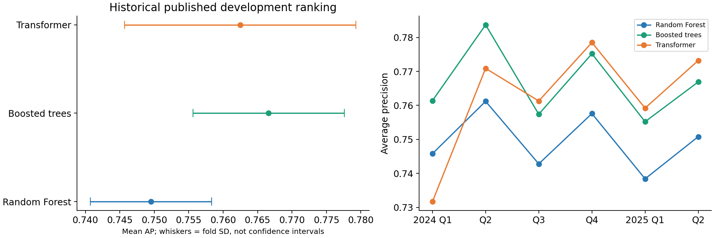
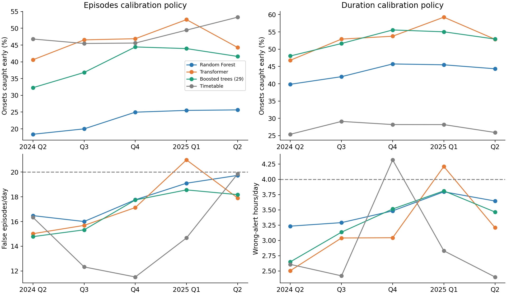
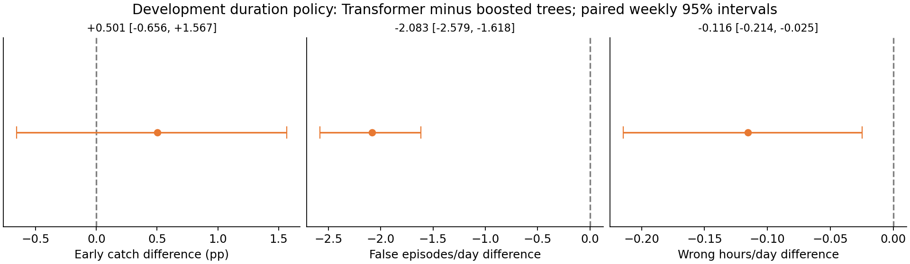
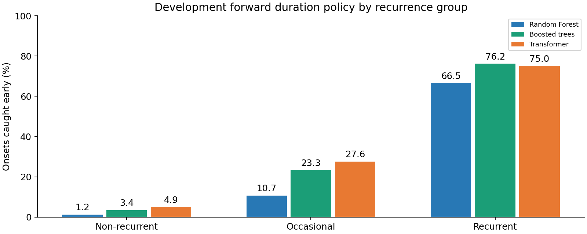
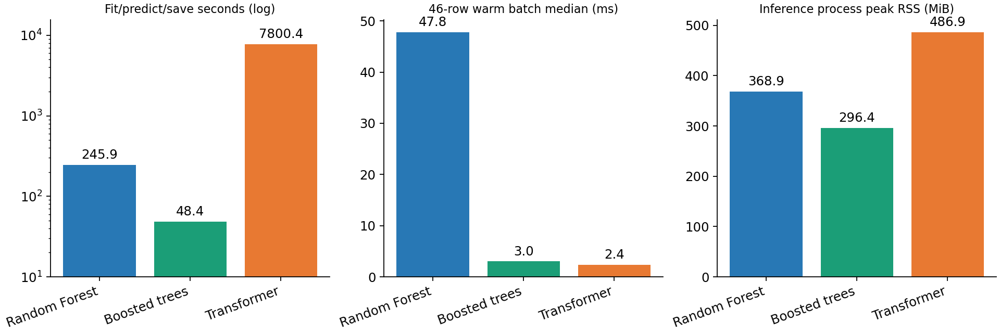
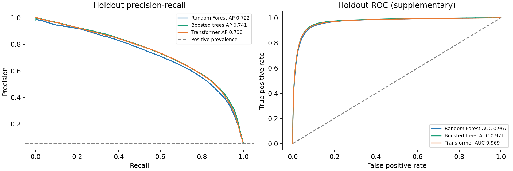
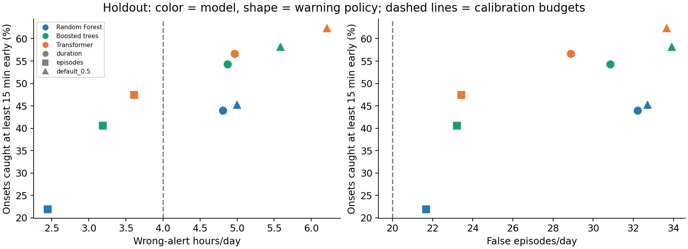

# SafeFlow: congestion early warning

**Can we warn of freeway congestion before it starts, at a manageable warning burden?**

At each station, every five minutes, predict whether measured speed will fall below **40 mph at any point in the next 30 minutes**. This page is a working overview of the repository's results, with completed evidence separated from pending work.

> **Updated 2026-11-04 16:17 EST.** Development analyses and the full local benchmark are complete. The July-December 2025 holdout has now been evaluated once with frozen checkpoints and calibration-derived thresholds.

[Training and notebook guide](../notebooks/README.md) | [Project setup](../README.md) | [Published metrics](../notebooks/results/summary.csv) | [Detailed tables and methods](#detailed-tables-and-methods)

## Reading the warning policies

A **warning policy** is an alerting rule: issue a warning when a predicted probability reaches a threshold chosen on earlier calibration data. Each model has its own frozen threshold. This does not prescribe a traffic-control action.

A **warning budget** is an illustrative target for acceptable false-warning burden, not a guaranteed future limit. The duration policy targets at most **4 wrong-alert hours/day**, summed across stations; the episode policy targets at most **20 false-warning episodes/day**. Both maximize early detection within their calibration target. The fixed 0.5 threshold is a separate diagnostic policy.

One continuous 30-minute wrong warning is **one episode and 0.5 hours**; six separated five-minute wrong warnings are **six episodes and the same 0.5 hours**. Duration and episode counts measure different burdens. In the original tradeoff plots, circle/square/triangle mean duration/episode/fixed 0.5; colors identify models. Actual holdout burden can exceed the target, as it did here, so equal intended budgets are not exactly matched-cost comparisons.

## What the evidence says so far

- **Holdout AP:** boosted trees **0.7412**, Transformer **0.7380**, Random Forest **0.7216**. Transformer catches more onsets early under the frozen duration policy, but **all three models exceed the intended warning budgets**.
- **Boosted trees lead on ranking quality:** mean development AP **0.7666**, compared with **0.7625** for Transformer and **0.7495** for Random Forest.
- **Transformer and boosted trees are close on early detection:** **53.2% versus 52.7%** under the forward duration-budget policy. The paired interval does not clearly separate them; Transformer generated lower average warning burden under that policy.
- **Unusual congestion is the main weakness:** all models miss most non-recurrent onsets when at least 15 minutes of warning is required.

## 1. Ranking quality across time

Boosted trees have the highest published mean AP; Transformer is close. The whiskers show **fold standard deviation, not confidence intervals**. These are the current six-fold results, including the November 4 boosted-tree update. AP measures ranking of eligible forecast origins; it is not the fraction of onset events warned early.

[Source tables](../notebooks/results/summary.csv) | [Comparison notebook](../notebooks/archive/analysis/compare_models_29_features.ipynb)

## 2. Do warning budgets carry into the next quarter?

Thresholds are selected using **earlier quarters only**, then frozen for the next quarter. Dashed lines are calibration budgets; actual next-quarter costs may exceed them. Transformer exceeded each selected budget in one of five quarters. Under the duration policy, it caught **53.2%** of onsets versus **52.7%** for boosted trees and **43.5%** for Random Forest. These are equal intended budgets, not identical realized costs.

[Forward-policy notebook](../notebooks/archive/analysis/forward_warning_budget_validation.ipynb) | [Quarterly results](forward_warning_budget_validation/20261104_102956_926783/quarterly_policies.csv)

## 3. Is the Transformer advantage convincing?

The primary detection difference is **+0.50 percentage points**, with a weekly 95% interval of **-0.66 to +1.57**. This does not establish superior detection or equivalence. The average false-episode and wrong-duration differences favor Transformer under this frozen duration policy. Intervals use 5,000 paired weekly resamples and condition on existing fitted models and thresholds; they do not cover feature selection, retraining uncertainty or future regime shifts.

[Uncertainty notebook](../notebooks/archive/analysis/model_decision_analysis.ipynb) | [All intervals and daily sensitivity](model_decision_analysis/20261104_104058_694019/paired_intervals.csv)

## 4. The hard cases: non-recurrent congestion

Under the duration policy, Transformer caught only **4.9%** of non-recurrent onsets early, boosted trees **3.4%**, and Random Forest **1.2%**. Grouping uses each fold's training-only usual congestion rate 15 minutes before onset. The 33 onsets with missing recurrence context are excluded from these groups but retained in overall detection. Improving these hard cases matters more than a small aggregate-score gain.

[Recurrence results](forward_warning_budget_validation/20261104_102956_926783/recurrence_summary.csv) | [Error-analysis notebook](../notebooks/archive/analysis/error_analysis_models.ipynb)

## 5. Deployment practicality: completed local benchmark

| Model | Last-fold AP | Fit/predict/save | Batch 46 median | Inference peak RSS |
| --- | --- | --- | --- | --- |
| Random Forest | 0.7509 | 4.10 min | 47.83 ms | 368.9 MiB |
| Boosted trees | 0.7669 | 0.81 min | 3.02 ms | 296.4 MiB |
| Transformer | 0.7713 | 130.01 min | 2.39 ms | 486.9 MiB |

Transformer has the highest AP in this fresh last-fold run and the lowest warm small-batch latency. Its fit/predict/save stage took about **130 minutes**, versus **0.81 minutes** for boosted trees and **4.10 minutes** for Random Forest. Boosted trees were faster over the complete 38,640-endpoint fixture: **0.50 seconds**, versus **2.03 seconds** for Transformer and **4.00 seconds** for Random Forest. Inference speed therefore depends on batch size and whether encoding/building costs are included.

These are fresh one-fold results, not replacements for the six-fold published means or the earlier forward policies. At threshold 0.5, Transformer's higher early catch also came with greater warning burden. Small-batch latency starts from cached engineered features; raw-to-feature extraction is excluded. Peak RSS includes dependencies, fixture data and optional stress tests. No holdout data was used.

[Completed benchmark tables](local_model_benchmark/20261104_115016_080613/manifest.json) | [Benchmark notebook](../notebooks/archive/analysis/local_model_benchmark.ipynb)

## 6. Frozen-checkpoint holdout evaluation

| Model | Holdout AP | Brier | Early catch: duration policy | Actual wrong hours/day |
| --- | --- | --- | --- | --- |
| Boosted trees | 0.7412 | 0.0238 | 54.3% | 4.87 |
| Transformer | 0.7380 | 0.0240 | 56.7% | 4.97 |
| Random Forest | 0.7216 | 0.0248 | 43.9% | 4.81 |

The test covers 966,000 rows, 125 days and 3,497 onsets. Checkpoints were fitted before April; April-June supplied calibration. No holdout fitting or threshold adaptation occurred. Under the duration policy, Transformer gains 2.34 detection percentage points over boosted trees (weekly interval +1.19 to +3.49), with 0.097 additional wrong-alert hours/day (interval spanning zero). All duration and episode calibration budgets were exceeded. These results do not establish performance at identical realized cost.

[Full holdout report](holdout_evaluation/20261104_160843_077282/HOLDOUT_REPORT.md) | [Frozen protocol](holdout_evaluation/20261104_160843_077282/frozen_protocol.json) | [Independent verification](holdout_evaluation/20261104_160843_077282/verification.json)

## Current decision and next steps

All three models are retained, with **Transformer and boosted trees as leading candidates**, and no single final model designated. Use the completed local measurements to compare detection and actual warning burden together with deployment cost, and investigate non-recurrent congestion. The optional missing-feature tests are diagnostics, not causal raw-detector outage simulations. The holdout is now used; further tuning needs fresh independent validation.

## Detailed tables and methods

Expand evaluation definitions, complete metric tables, caveats and training progress

## Task and evaluation design

At each station and 5-minute timestamp, predict whether measured speed will be **below 40 mph at any of the next six readings** (the next 30 minutes). All three models use the shared 29 logical features. Transformer additionally consumes up to 24 historical feature vectors; the tabular models consume the current engineered feature vector, which already contains lag and spatial information.

The published development comparison uses six quarterly expanding walk-forward folds, 2024 Q1 through 2025 Q2, with a seven-day training gap. AP (average precision) measures probability ranking on the eligible, currently uncongested forecast origins; it is not event detection recall. Early detection measures the fraction of onset events warned at least 15 minutes before they begin.

An onset is a measured congested reading after 30 minutes of measured uncongested readings. False-warning episodes count starts of consecutive known-negative warning readings; wrong-alert duration counts those readings at five minutes each. Costs are corridor-wide, summed across stations per evaluated day.

## Published six-fold comparison: 29 features

| Model | Mean AP | AP std | Worst-fold AP | Brier | Early catch at 0.5 | False episodes/day at 0.5 | Wrong hours/day at 0.5 |
| --- | --- | --- | --- | --- | --- | --- | --- |
| Boosted trees | 0.7666 | 0.0110 | 0.7552 | 0.0220 | 63.9% | 31.10 | 5.04 |
| Transformer | 0.7625 | 0.0168 | 0.7317 | 0.0223 | 66.3% | 30.43 | 5.54 |
| Random Forest | 0.7495 | 0.0088 | 0.7384 | 0.0230 | 52.6% | 30.05 | 4.46 |

These are published fold-averaged metrics. **A common threshold of 0.5 does not equalize warning burden:** probability calibration and score distributions differ between models. Higher AP does not automatically mean higher early event detection or lower operational cost.

Source: [published summary](../notebooks/results/summary.csv). Historical pooled budget selection in [error analysis](../notebooks/archive/analysis/error_analysis_models.ipynb) is exploratory because the same predictions selected and evaluated thresholds; the forward test below is more informative about threshold transfer.

## Forward warning-budget validation

Each model gets its own threshold, selected using all **earlier out-of-fold quarters only**, then frozen and evaluated in the next quarter. Q1 2024 initializes calibration; Q2 2024 through Q2 2025 provide **five evaluated quarters, 313 days and 7,587 onsets**. Detection is weighted by onsets and cost by days. No next-quarter retuning forces realized costs to the calibration budget.

### Calibration budget: 4 wrong-alert hours/day

| Model | Early catch | Actual false episodes/day | Actual wrong hours/day | Quarters over selected budget |
| --- | --- | --- | --- | --- |
| Transformer | 53.2% | 21.12 | 3.19 | 1/5 |
| Boosted trees | 52.7% | 23.21 | 3.31 | 0/5 |
| Random Forest | 43.5% | 26.09 | 3.49 | 0/5 |
| Timetable | 27.4% | 6.68 | 2.91 | 1/5 |

### Calibration budget: 20 false-warning episodes/day

| Model | Early catch | Actual false episodes/day | Actual wrong hours/day | Quarters over selected budget |
| --- | --- | --- | --- | --- |
| Transformer | 46.3% | 17.32 | 2.43 | 1/5 |
| Boosted trees | 39.9% | 16.90 | 2.17 | 0/5 |
| Random Forest | 23.0% | 17.80 | 1.99 | 0/5 |
| Timetable | 48.2% | 14.95 | 6.78 | 0/5 |

These are equal **intended calibration budgets**, not identical realized costs. Transformer exceeded each selected budget in one evaluation quarter; this is not erased by retuning. Timetable detection under the episode policy comes with 6.78 wrong-alert hours/day, illustrating why episode count alone can hide prolonged warning burden.

Sources: [executed forward notebook](../notebooks/archive/analysis/forward_warning_budget_validation.ipynb), [summary](forward_warning_budget_validation/20261104_102956_926783/summary.csv), [quarterly policies](forward_warning_budget_validation/20261104_102956_926783/quarterly_policies.csv), [detection and burden plot](forward_warning_budget_validation/20261104_102956_926783/forward_detection_and_burden.png).

## Paired uncertainty: Transformer minus boosted trees

The analysis uses **5,000 paired calendar-week bootstrap resamples within each quarter**, keeping all stations and days in the sampled week together. There are 69 quarter/week blocks. Daily resampling is a sensitivity analysis. Both models use identical draws and frozen forward policies.

| Duration-policy metric | Difference | Weekly 95% interval |
| --- | --- | --- |
| Early detection | +0.501 pp | [-0.656, +1.567] pp |
| False episodes/day | -2.083 | [-2.579, -1.618] |
| Wrong-alert hours/day | -0.116 | [-0.214, -0.025] |
| Non-recurrent early detection | +1.496 pp | [+0.000, +2.996] pp |

Positive detection differences favor Transformer; negative cost differences favor Transformer. The duration-policy detection interval contains zero, while both average warning-cost intervals are below zero. Under the episode policy, Transformer gains 6.33 detection percentage points (interval +5.19 to +7.43), with 0.254 additional wrong-alert hours/day (interval +0.175 to +0.330).

For rare onsets, the weekly duration-policy detection interval touches zero, while the daily interval excludes zero. That subgroup conclusion is sensitive to the temporal dependence assumption. Intervals condition on saved fits and selected thresholds; they exclude retraining, threshold-selection and feature/model-selection uncertainty. They do not guarantee future-quarter burden or replace final holdout evaluation.

Sources: [model decision notebook](../notebooks/archive/analysis/model_decision_analysis.ipynb), [all intervals](model_decision_analysis/20261104_104058_694019/paired_intervals.csv), [interval visualization](model_decision_analysis/20261104_104058_694019/paired_uncertainty.png).

## Non-recurrent congestion is the main predictive weakness

Recurrence is determined from the fold-specific, training-only usual congestion rate at onset minus 15 minutes: below 10% is non-recurrent, 10%-40% occasional, and at least 40% recurrent. The five forward-evaluation quarters include **1,136 non-recurrent onsets**; 33 of the 7,587 total onsets lack usable recurrence context and remain included in overall detection.

| Model | Caught at least 15 min early | Non-recurrent onsets | Catch rate |
| --- | --- | --- | --- |
| Transformer | 56 | 1136 | 4.93% |
| Boosted trees | 39 | 1136 | 3.43% |
| Random Forest | 14 | 1136 | 1.23% |

Small improvements in aggregate AP should not obscure this weakness. A model can rank imminent slowdowns well and still fail to warn of an unusual onset early enough. Source: [recurrence table](forward_warning_budget_validation/20261104_102956_926783/recurrence_summary.csv).

## Completed local benchmark: full last development fold

Run: [`20261104_115016_080613`](local_model_benchmark/20261104_115016_080613/manifest.json). Status: **complete**. All three models used the current shared features, 2,000,000 common training endpoints, 486,864 validation endpoints, and four CPU threads. The inference fixture contains 38,640 endpoints from five development days; timings use 20 warmups and 200 measured batches. There are 1,536 onsets in the full validation fold.

| Model | Fit + predict + save (s) | Fixture prediction (s) | Batch 1 median (ms) | Batch 46 median (ms) | Checkpoint (MiB) | Inference peak RSS (MiB) |
| --- | --- | --- | --- | --- | --- | --- |
| Random Forest | 245.92 | 3.995 | 38.246 | 47.827 | 19.886 | 368.9 |
| Boosted trees | 48.45 | 0.499 | 2.850 | 3.015 | 0.473 | 296.4 |
| Transformer | 7800.38 | 2.033 | 0.493 | 2.391 | 0.285 | 486.9 |

Transformer has the highest AP in this fresh last-fold run and the lowest warm small-batch latency. Its fit/predict/save stage took about **130 minutes**, versus **0.81 minutes** for boosted trees and **4.10 minutes** for Random Forest. Boosted trees were faster over the complete 38,640-endpoint fixture: **0.50 seconds**, versus **2.03 seconds** for Transformer and **4.00 seconds** for Random Forest. Inference speed therefore depends on batch size and whether encoding/building costs are included.

All three checkpoints reproduced saved probabilities within tolerance (RF maximum error about 5.6e-16; boosted trees and Transformer zero). Transformer has the smallest serialized checkpoint here, but the largest fresh inference-process peak RSS. Serialized weights do not measure total deployment memory.

### Fresh local predictive metrics: last fold only

| Model | AP on eligible origins | Early catch at 0.5 | False episodes/day at 0.5 | Wrong hours/day at 0.5 |
| --- | --- | --- | --- | --- |
| Random Forest | 0.7509 | 49.9% | 29.10 | 4.15 |
| Boosted trees | 0.7669 | 60.9% | 30.29 | 4.60 |
| Transformer | 0.7713 | 66.8% | 30.98 | 5.17 |

These are fresh one-fold results, not replacements for the six-fold published means or the earlier forward policies. At threshold 0.5, Transformer's higher early catch also came with greater warning burden. Small-batch latency starts from cached engineered features; raw-to-feature extraction is excluded. Peak RSS includes dependencies, fixture data and optional stress tests. No holdout data was used.

### Transformer training and missing-feature diagnostics

All **10 epochs** finished, with training BCE decreasing from 0.0813 to 0.0709. Recorded epoch execution totaled 129.4 minutes; the complete fit/predict/save stage took 130.0 minutes. Training loss is not validation AP.

All three workers also completed nine missing-feature scenarios each, alongside clean predictions: **30 scenario rows** in [feature_stress.csv](local_model_benchmark/20261104_115016_080613/feature_stress.csv). These mask feature families at 11:00 for 5/15/30 minutes while keeping labels fixed; they are diagnostics on five days, not causal raw-detector outage simulations.

Sources: [training](local_model_benchmark/20261104_115016_080613/training.csv), [inference and reproduction](local_model_benchmark/20261104_115016_080613/inference.csv), [latency](local_model_benchmark/20261104_115016_080613/latency.csv), [predictive metrics](local_model_benchmark/20261104_115016_080613/predictive_metrics.csv), and [executed notebook](../notebooks/archive/analysis/local_model_benchmark.ipynb). Large fitted models and fixtures remain local. The original Transformer provenance mismatch still applies to historical exports; these new fits use the current shared source.

## Next steps for the comparative study

1. Compare the completed last-fold predictive and operational results together, while preserving the distinction from six-fold and forward-policy estimates.
2. Compare fresh last-fold detection and actual burden together with latency, training cost and memory. A small AP or detection difference alone is not a decisive deployment argument.
3. Investigate non-recurrent congestion and run causal raw-detector outage tests if outage robustness is part of the intended deployment claim.
4. Preserve the frozen-checkpoint holdout results. Any subsequent model or policy tuning requires a new independent test period.

**Current conclusion:** keep Transformer and boosted trees as the leading candidates. Transformer has favorable early-warning development evidence under the selected duration policy; boosted trees have the best published mean AP and strong completed local efficiency measurements. The local benchmark now quantifies their training and inference tradeoffs; the frozen-checkpoint holdout has now been evaluated and does not support a budget-compliant winner at the intended cap.

---

*Static work-in-progress snapshot. Figures are stored alongside this page for GitHub rendering. [Figure provenance](final/report_manifest.json) records their source artifacts. The completed full-run notebook and aggregate tables are linked above. This remains a developmental project snapshot, not a holdout report.*
