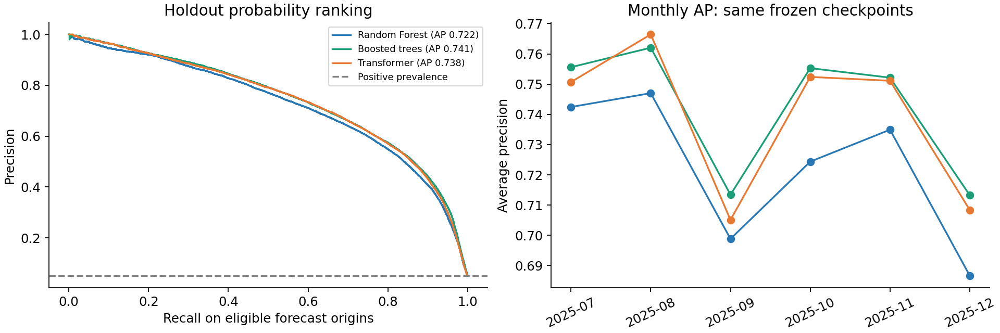
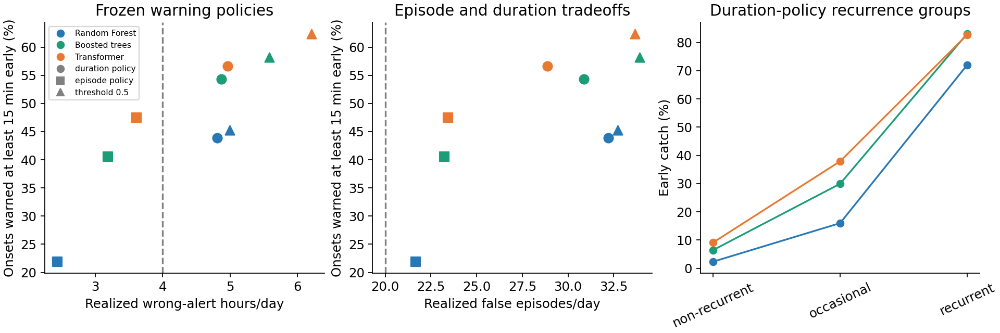

# Frozen-checkpoint holdout evaluation

**Completed 2026-11-04 16:17 EST.** Evaluated July-December 2025 once under a protocol frozen before reading the holdout. No model fitting or threshold tuning used holdout outcomes. The holdout is now **used**, not untouched.

## Reading the warning policies

A **warning policy** is an alerting rule: issue a warning when a predicted probability reaches a threshold chosen on earlier calibration data. Each model has its own frozen threshold. This does not prescribe a traffic-control action.

A **warning budget** is an illustrative target for acceptable false-warning burden, not money and not a guaranteed future limit. The duration policy targets at most **4 wrong-alert hours/day**, summed across stations; the episode policy targets at most **20 false-warning episodes/day**. Both maximize early detection within their calibration target. The fixed 0.5 threshold is a separate diagnostic policy.

One continuous 30-minute wrong warning is **one episode and 0.5 hours**; six separated five-minute wrong warnings are **six episodes and the same 0.5 hours**. Duration and episode counts measure different burdens. In the original tradeoff plots, circle/square/triangle mean duration/episode/fixed 0.5; colors identify models. Actual holdout burden can exceed the target, as it did here, so equal intended budgets are not exactly matched-cost comparisons.

## Main results

| Model | Holdout AP | Brier | Early catch: duration policy | Actual wrong hours/day |
| --- | --- | --- | --- | --- |
| Boosted trees | 0.7412 | 0.0238 | 54.3% | 4.87 |
| Transformer | 0.7380 | 0.0240 | 56.7% | 4.97 |
| Random Forest | 0.7216 | 0.0248 | 43.9% | 4.81 |

Boosted trees have the highest point-estimate AP and lowest Brier score. Transformer catches more onsets at least 15 minutes early under the frozen duration policy, but its actual wrong-alert duration is also slightly higher. **Every model exceeds the intended 4 wrong-alert-hours/day budget.** No model can be declared compliant with a strict 4-hour cap under these frozen thresholds.

## What was frozen before access

- **Models:** the three completed local benchmark checkpoints, trained on the same two-million-endpoint sample from the last development fold. Their training target windows end before March 25, 2025. They were not refitted through June.
- **Calibration:** April-June 2025 predictions from those same checkpoints. Per-model episode and duration thresholds were selected on this calibration quarter only; 0.5 was retained as a separate diagnostic policy.
- **Primary warning comparison:** at least 15 minutes of onset warning, using the policy calibrated to 4 wrong-alert hours/day. Secondary policies target 20 false episodes/day or use threshold 0.5.
- **Features:** the current shared 29-feature module, the development station graph, and the original checkpoint training-period typical statistics. Imputers, scales and model weights were loaded from saved checkpoints, not refitted.
- **Test scope:** July 1-December 31, 2025; weekdays excluding federal holidays, retained forecast origins 06:00-19:55, with the shared complete-future-label requirements.

The [frozen protocol](frozen_protocol.json), [its digest](frozen_protocol.sha256), [access record](holdout_access.json) and [frozen thresholds](frozen_policies.csv) establish the sequence. Independent verification confirmed that the protocol timestamp precedes first access and its hash is unchanged. This is a clean train/calibrate/test evaluation of existing checkpoints, **not** a final refit using all pre-holdout data.

## Coverage and data quality

- **966,000** station-time rows from **46** stations and **125** evaluated days.
- **636,806** rows with known future outcomes; **556,199** eligible origins for primary AP.
- **3,497** onset events. Month-level counts are in [monthly coverage](monthly_coverage.csv).
- November 28, 2025 is missing among expected eligible business days. No replacement observations were fabricated.
- Duplicate keys and nonfinite measured mainline speeds were checked. Target flags and onsets were independently reconstructed and matched the saved labels.
- Recomputed April-June feature inputs reproduce the exact checkpoint input features, confirming unchanged training-period statistics. All three models use identical holdout keys and labels.

## Frozen warning policies

### Duration budget: 4 wrong-alert hours/day

| Model | Threshold | Early catch | False episodes/day | Wrong hours/day |
| --- | --- | --- | --- | --- |
| Random Forest | 0.510935 | 43.9% | 32.21 | 4.81 |
| Boosted trees | 0.543468 | 54.3% | 30.86 | 4.87 |
| Transformer | 0.583390 | 56.7% | 28.88 | 4.97 |

The realized duration exceeds the calibration cap by about 20%-24%. The thresholds were not adjusted to force holdout compliance.

### Episode budget: 20 false episodes/day

| Model | Threshold | Early catch | False episodes/day | Wrong hours/day |
| --- | --- | --- | --- | --- |
| Random Forest | 0.690001 | 21.9% | 21.67 | 2.44 |
| Boosted trees | 0.669026 | 40.5% | 23.22 | 3.19 |
| Transformer | 0.683885 | 47.4% | 23.42 | 3.61 |

All three episode policies also exceed their 20-episode/day calibration budget. Counts and warning duration capture different operational costs.

### Fixed diagnostic threshold: 0.5

| Model | Threshold | Early catch | False episodes/day | Wrong hours/day |
| --- | --- | --- | --- | --- |
| Random Forest | 0.500000 | 45.3% | 32.71 | 4.99 |
| Boosted trees | 0.500000 | 58.2% | 33.90 | 5.58 |
| Transformer | 0.500000 | 62.4% | 33.65 | 6.21 |

These thresholds do not equalize warning burden. Higher detection at 0.5 should be read together with the cost columns.

## Paired uncertainty: Transformer minus boosted trees

The duration-policy comparison uses 5,000 paired weekly resamples within Q3 and Q4, retaining all stations together: **28 quarter/week blocks**. Intervals condition on these fitted checkpoints and frozen thresholds and do not include retraining or model-selection uncertainty. The subgroup comparison is secondary and has no multiplicity adjustment.

| Metric | Difference | Weekly 95% interval | Units |
| --- | --- | --- | --- |
| catch_15min | +2.345 | [+1.193, +3.495] | percentage points |
| false_episodes_per_day | -1.976 | [-2.543, -1.371] | episodes/day |
| wrong_alert_hours_per_day | +0.097 | [-0.052, +0.283] | hours/day |
| rare_catch_15min | +2.681 | [+0.722, +4.448] | percentage points |

Transformer gains **2.34 percentage points** of early detection (interval **+1.19 to +3.49**) and produces **1.98 fewer false episodes/day**. Its wrong-alert duration is **0.097 hours/day higher**, with an interval spanning zero. This is not an exactly matched-cost comparison, and both policies exceed the intended duration cap. AP differences were not assigned bootstrap intervals in this analysis.

## Non-recurrent onsets

| Model | Caught early | Non-recurrent onsets | Early catch |
| --- | --- | --- | --- |
| Random Forest | 15 | 634 | 2.37% |
| Boosted trees | 41 | 634 | 6.47% |
| Transformer | 58 | 634 | 9.15% |

There are 634 non-recurrent, 918 occasional and 1,904 recurrent onsets; 41 events have missing recurrence context and remain in the overall denominator. Recurrence uses training-only usual congestion 15 minutes before onset. Non-recurrent early warning remains weak despite Transformer's advantage.

## Comparison with the preceding calibration quarter

| Model | April-June AP | July-December AP | AP change |
| --- | --- | --- | --- |
| Random Forest | 0.7509 | 0.7216 | -0.0293 |
| Boosted trees | 0.7669 | 0.7412 | -0.0257 |
| Transformer | 0.7713 | 0.7380 | -0.0333 |

All three point estimates are lower on holdout. Seasonal composition, case mix and aging of the fixed models may contribute; this comparison does not identify a causal explanation. The monthly plot shows variation within the test period. These one-checkpoint holdout metrics are separate from six-fold development averages.

## Verification and execution

The [verification record](verification.json) confirms unchanged checkpoint and protocol hashes, independent target/onset checks, agreement of all nine policy cost/catch results with the exact sweep, and an unchanged published team summary. Eleven synthetic isolation/scorer/bootstrap tests passed before holdout access. A Windows DLL import-order failure occurred before Transformer prediction; [the execution amendment](execution_amendment.json) records the fix. No model, feature or threshold settings changed.

## Interpretation and remaining decisions

Boosted trees lead on holdout AP, Brier and bulk fixture throughput, and train much faster. Transformer leads on early onset detection under the frozen policies and on warm small-batch latency in the local benchmark. Which is preferable depends on the predeclared operational objective; **none meets a strict 4-hour/day wrong-alert cap in this holdout test**. The small AP difference alone does not establish overall superiority.

The holdout has now been evaluated. Future tuning or policy revisions must not be presented as another untouched test on this same period; they require new independent validation. These results apply to the frozen pre-April checkpoints and this D12 cohort, not to hypothetical refits through June or to D7.

## Artifacts

- [All holdout metrics](holdout_metrics.csv), [monthly metrics](monthly_metrics.csv), [recurrence metrics](recurrence_metrics.csv), [paired intervals](paired_duration_intervals.csv).
- [Evaluation manifest](evaluation_manifest.json), [raw input provenance](holdout_input_provenance.json), [verification](verification.json).
- Model prediction exports: `random_forest_holdout_predictions.parquet`, `boosted_trees_holdout_predictions.parquet`, `transformer_holdout_predictions.parquet`.
- Evaluator: [evaluate_holdout.py](../../../src/analysis/evaluate_holdout.py). The default shared loader still excludes the holdout; only this dedicated evaluator opens the authorized date range.
